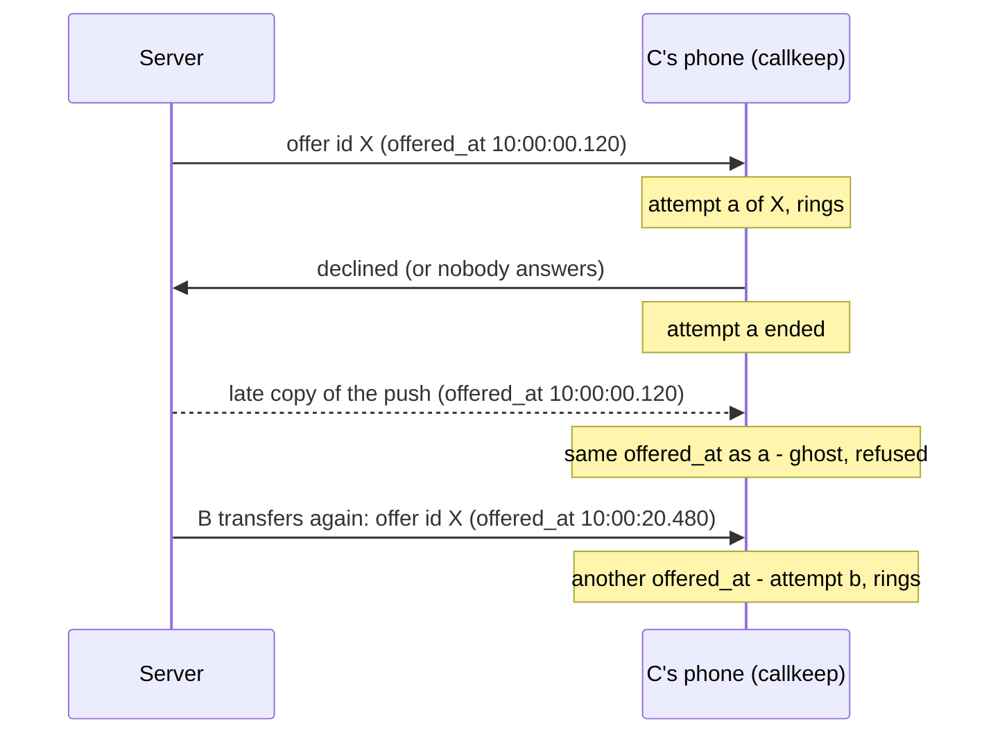
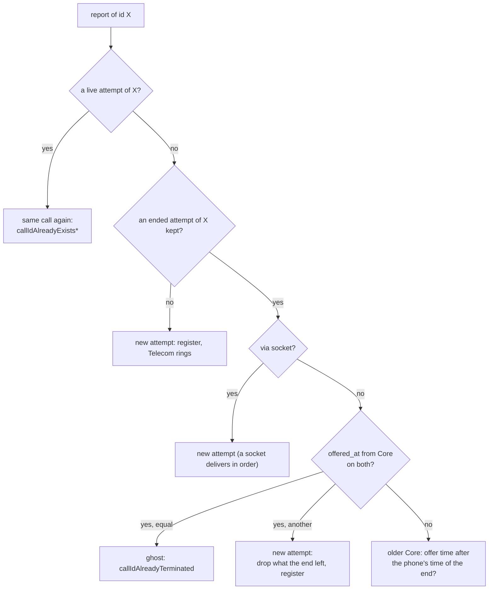

# Incoming-call lifecycle: one call id, many reports

An incoming call is known by its call id, and the same id reaches the phone more than once: from
the signaling socket, from a push, from a handshake after a reconnect, sometimes from an SMS. This
page follows one id from its first report to its end, and shows how the app tells apart the four
things such a report can be:

- **the call itself**, reported for the first time;
- **the same call again**, from another path - joined to the call already ringing;
- **a ghost** - a late copy of a call that is already over, which must not ring;
- **a new attempt** - the server offering the same id again after the earlier attempt ended (a
  transfer back, a blind transfer repeated to the same person), which must ring.

PortaSwitch reuses the SIP Call-ID, so a call id names a conversation, not a call on this phone.
Each offer of an incoming call is therefore resolved to an **attempt** with an id of its own, and
whatever the app has to remember about a call after its end is kept per attempt, not per call id.

How a call is delivered per app state and mode (push isolate, persistent socket, foreground) is in
[incoming_call_scenarios.md](incoming_call_scenarios.md). The native side is in the callkeep docs
`webtrit_callkeep_android/docs/incoming-call-handling.md` and `connection-tracker.md`.

## Where a report comes from

Every path ends in the same native call, `CallkeepCore.registerIncomingCall` on Android, and every
path says when the server offered the call (`offeredAt`), where that time comes from
(`CallkeepOfferTimeSource`) and how the offer arrived (`CallkeepOfferVia`).

Core stamps each offer with `offered_at`, epoch milliseconds by Core's clock:

- **When.** The moment Core learned of the offer, when Janus reported its `incomingcall` - once per
  INVITE to this app. Core takes it once and puts the same value on every path: the
  `incoming_call` event (`offered_at`), the push (`offeredAt`, a string, FCM and APNs VoIP alike)
  and the handshake's call log, where it is the time of the `incoming_call` entry.
- **Whose.** Each app gets its own value: Core stamps the offer in the controller of the app it is
  for, so two phones of one user see different values for one call. Values are compared only within
  one app.
- **What it is for.** It identifies the offer. A late copy of an offer (a push FCM delivered late, a
  handshake still listing the call) carries that offer's value; a new offer of the same Call-ID (a
  transfer back, a retried transfer) is a new INVITE and gets another. The app compares the values
  for **equality** only and never with a clock, so a phone clock that is off decides nothing.

Where each DTO holds it: `IncomingCallEvent.offeredAt` (signaling), `offeredAt` of the Android push
(`android_pending_call_handler.dart`) and of the iOS VoIP payload (`WebtritCallkeepPlugin.m`), and
`CallLog.timestamp` of the handshake's `incoming_call` entry.

| Path | Code | Offer time with `offered_at` | Without it (older Core) | Via |
| --- | --- | --- | --- | --- |
| Live event on the app's socket | `CallBloc`, via `call_signaling_event_mapping.dart` | `core` | the moment the event arrived (`clock.now()`), `device` | `socket` |
| Live event on the persistent socket (Android 14+, foreground service) | `onSignalingBackgroundCallEvent` | `core` | the moment the event arrived, `device` | not named |
| FCM push | `_handleBackgroundMessage` in `bootstrap.dart` | `core` | `RemoteMessage.sentTime`, `fcm` | `push` |
| SMS trigger | `IncomingCallSmsTriggerReceiver` | - | the time the SMS centre took the message, taken as `fcm` | not named |
| Handshake after a (re)connect | `_handleHandshakeReceived` in `CallBloc`, via `handshake_processor.dart` | `core` | the server's time of the newest `incoming_call` in the line's call log, also `core` | `handshake` |

The `fcm` and `device` sources are temporary: they exist only while the app supports a Core that does
not send `offered_at`, and go once the app's minimum Core (`WEBTRIT_APP_CORE_VERSION_CONSTRAINT`)
sends it. The code marks them `TEMPORARY(old Core without offered_at)`.

The handshake is how the app learns of a call that started while it had no socket and whose push did
not arrive: the server sends no live event to a connection opened after the offer, only its lines
once the connection is up, each with a log of the call's events and the server's time of each.
In the persistent mode the app gets its handshake from the foreground service, which renders it
from the session it holds (`SessionSnapshot`): an event the service heard live is logged at the
moment it arrived, by the phone's clock - the same time a live socket event is given.

## A direct call

A calls C. The server offers C the call on the paths it has to C: the socket while C's app holds
one, a push to wake the app when it does not, and often both.

1. The first report registers the call: callkeep reserves the id, Telecom creates the connection,
   the phone rings.
2. Any further report of the same id while it rings is **the same call again**: callkeep answers
   `callIdAlreadyExists` (or `callIdAlreadyExistsAndAnswered` once it was answered), and the bloc
   joins the report to the call it holds - for example it stores the SDP offer that only the socket
   carries.
3. The call ends. How it ended decides what callkeep remembers about the id:
   - the app held the call (it was in `CallBloc` state): the id is simply free again. A transfer
     back to C reuses such an id and rings normally.
   - the app never held it - the caller gave up before the app started, the push isolate rang it
     and C declined from the notification, or C did not answer while the app was in the
     background: the end is reported with `missedWhileConnecting` or `declinedByUser`, and callkeep
     keeps **the time of that end** for the id.

   Either way the end also drops callkeep's reservation of the id, whichever process ended it - the
   push session's release included - so the id is not left looking like a call still being
   registered.

That kept end is what stops ghosts. Copies of the call keep arriving after it is over: a push FCM
delivered late, a handshake that still lists the call, a connection-state replay when the app's
Activity attaches. None of them may ring.

## A blind transfer repeated, a transfer back

A talks to B. B blind-transfers A to C. C declines, or does not answer. B transfers A to C again.
PortaSwitch offers C **the same call id** both times. A transfer back is the same picture from the
other side: B transferred A away, A comes back to B under the id B already saw end.

The id cannot tell these two apart: both say X. Core's offer time can. A copy of the first attempt
carries that attempt's `offered_at`; the second attempt carries its own.

## The attempts in callkeep

**Android.** `CallAttempts` (main process) is the one owner of attempts. Every report of an incoming
call goes through `CallAttempts.resolve`, every end of a call ends its attempt:

What an end leaves behind and what a new attempt drops:

- the tracker's mark of an end the app never presented (`missedWhileConnecting`, `declinedByUser`);
- the pending release (`IC_RELEASE_ENDED`) an end leaves when no incoming-call service runs. The end
  of a call this phone made (presented, no incoming attempt) leaves none: the transfer back of that
  call would otherwise be ended by the service before it shows;
- the cancelled registration and the `tearDown` of the backend process (`ConnectionManager`,
  `StandaloneCallService`): keyed by the attempt id, which travels in `CallMetadata.attemptId` and in
  the cancellation command. A late Telecom callback of the cancelled attempt is still refused; a new
  attempt of the id is created.

The cases every platform's registry must decide the same way are in `callkeep/call_attempt_vectors.json`.

**iOS.** CallKit shows an incoming call under a UUID derived from its call id, and a UUID CallKit saw
end cannot be relied on a second time. `CallPresentations` keeps the last presentation of each call
that ended, with its Core `offered_at`:

- another `offered_at` - a new attempt, shown under a **fresh UUID**;
- the ended attempt's `offered_at` - a late copy: the app's report is answered `callIdAlreadyTerminated`,
  a VoIP push of it is reported under the ended UUID and ended at once if CallKit takes it;
- the answer or end CallKit gave a pushed call within the last 5 s (the action history) is not
  applied to a report taken as a new attempt.

**Dart `Callkeep`.** It keeps the ends it reported for calls the app never held
(`wasEndedBeforePresented`, the last 32) and drops a `didPresentIncomingCall` for such an id until a
registration reopens it. With Core's time, a registration with another `offered_at` than the ended
attempt's reopens the id also when the platform already holds the call from its push
(`callIdAlreadyExists`) - on iOS the push reaches CallKit first.

A refused report never rings. A refused push is dropped and logged by the background handler; a
refused socket or handshake report is ended by the bloc, which declines it on the server (603).

Attempts live in the memory of the app's process (Android: the last 64 ended ones, 10 minutes). A
process that dies forgets them, and so does `tearDown`. A late push that starts a fresh process has
no ended attempt to meet: the push isolate's handshake finds the call gone from the server and ends it.

## Without `offered_at`

With an older Core the rule is the one before attempts, and it is marked temporary in the code:

- Android compares the server's time of the offer (the push's `sentTime`, the handshake's call log)
  with this phone's time of the end of a call the app never presented: after it - a new attempt,
  at or before it - a ghost. An offer with only this phone's time is presented, as before.
- iOS presents the call as before, under the UUID of its call id; the action history applies.
- A late push of a call the app **held** is not told against its end: it rings until the push
  isolate's check on the server ends it.

## Limits

- **Two clocks, without `offered_at` only.** Every time here is milliseconds since the epoch in UTC.
  The offer time of a push, an SMS or a handshake is the network's, the end is this phone's clock: a
  phone clock set by hand a minute or more off the network's can let a late copy through or refuse a
  new attempt. With `offered_at` on both offers no clock is compared.
- **Two live legs of one id** on one phone (a forked call that reaches the same device twice) are one
  attempt: the second report is "the same call again".
- The web implementation applies the older rule to the ids it keeps as terminated.

## Where it is checked

- callkeep Android: `CallAttemptsTest` (the registry, with the shared `call_attempt_vectors.json`),
  `ForegroundServiceIncomingRegistrationTest` and `ReportCallEndedTest` (the rule for socket and push
  reports, the release a new attempt drops, no release for a call this phone made),
  `IncomingCallCancellationTest` (cancellation by attempt), `MainProcessConnectionTrackerTest`,
  `IncomingCallServiceReleaseTest`, `IncomingCallSmsTriggerReceiverTest`, `ForegroundServiceProxyTest`
  (the offer time, its source and via through Pigeon).
- callkeep Dart: `offered_at_forwarding_test.dart`, `ends_reported_unseen_test.dart` and
  `pending_call_offered_at_test.dart` (`webtrit_callkeep`), `webtrit_callkeep_android_offered_at_test.dart`,
  `offered_at_test.dart` (iOS: fresh UUID, ghost, action history), `webtrit_callkeep_web_new_attempt_test.dart`.
- phone: `incoming_call_event_test.dart` (`offered_at` of the event), `signaling_event_mapping_test.dart`,
  `incoming_offer_time_test.dart`, `handshake_processor_test.dart` and
  `background_signaling_incoming_test.dart`: the offer time, source and via each path reports.
