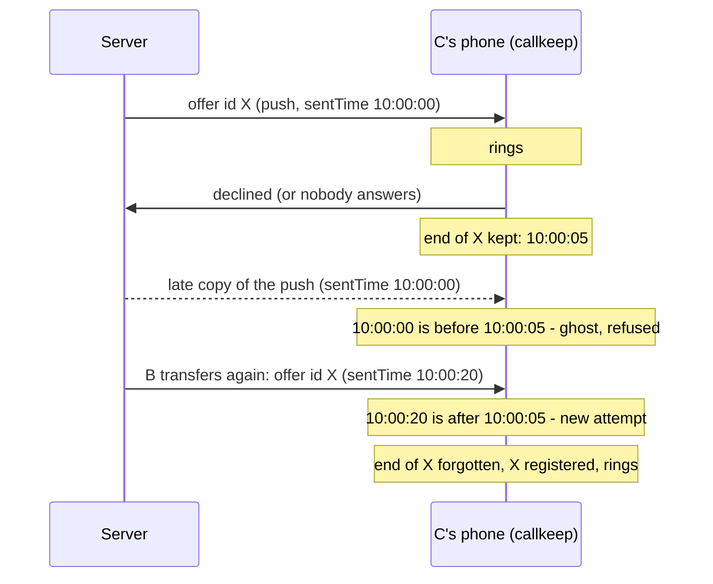
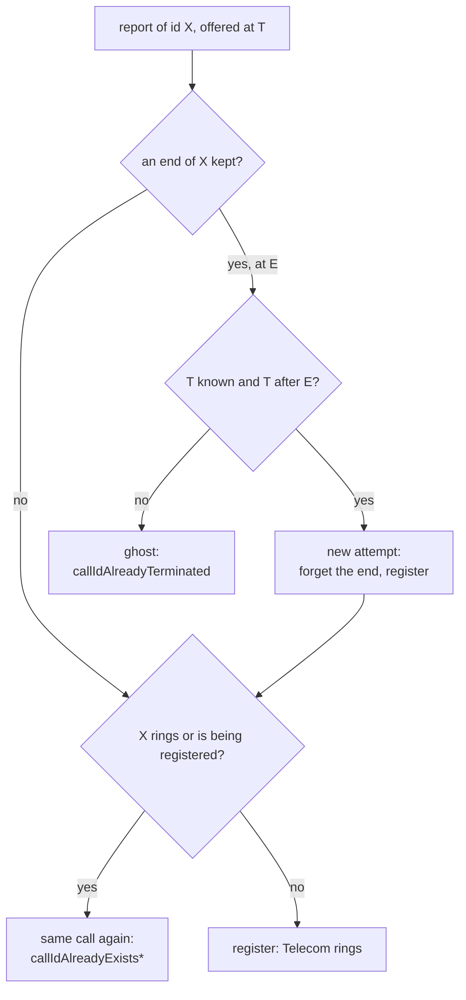

# Incoming-call lifecycle: one call id, many reports

An incoming call is known by its call id, and the same id reaches the phone more than once: from
the signaling socket, from a push, from a handshake after a reconnect, sometimes from an SMS. This
page follows one id from its first report to its end, and shows how the app tells apart the four
things such a report can be:

- **the call itself**, reported for the first time;
- **the same call again**, from another path - joined to the call already ringing;
- **a ghost** - a late copy of a call that is already over, which must not ring;
- **a new attempt** - the server offering the same id again after the earlier attempt ended (a
  blind transfer repeated to the same person), which must ring.

How a call is delivered per app state and mode (push isolate, persistent socket, foreground) is in
[incoming_call_scenarios.md](incoming_call_scenarios.md). The native side is in the callkeep docs
`webtrit_callkeep_android/docs/incoming-call-handling.md` and `connection-tracker.md`.

## Where a report comes from

Every path ends in the same native call, `CallkeepCore.registerIncomingCall` on Android, and every
path except the handshake says when the server offered the call (`offeredAt`):

| Path | Code | Offer time |
| --- | --- | --- |
| Live event on the app's socket | `CallBloc`, via `call_signaling_event_mapping.dart` | the moment the event arrived (`clock.now()`), before the bloc's queues |
| Live event on the persistent socket (Android 14+, foreground service) | `onSignalingBackgroundCallEvent` | the moment the event arrived |
| FCM push | `_handleBackgroundMessage` in `bootstrap.dart` | `RemoteMessage.sentTime` |
| SMS trigger | `IncomingCallSmsTriggerReceiver` | the time the SMS centre took the message |
| Handshake after a (re)connect | `_handleHandshakeReceived` in `CallBloc` | none: the handshake replays the server's lines, it does not offer anything |

## A direct call

A calls C. The server offers C the call on the paths it has to C: the socket while C's app holds
one, a push to wake the app when it does not, and often both.

1. The first report registers the call: callkeep reserves the id, Telecom creates the connection,
   the phone rings.
2. Any further report of the same id while it rings is **the same call again**: callkeep answers
   `callIdAlreadyExists` (or `callIdAlreadyExistsAndAnswered` once it was answered), and the bloc
   joins the report to the call it holds - for example it stores the SDP offer that only the socket
   carries.
3. The call ends. How it ended decides what callkeep remembers about the id:
   - the app held the call (it was in `CallBloc` state): the id is simply free again. A transfer
     back to C reuses such an id and rings normally.
   - the app never held it - the caller gave up before the app started, the push isolate rang it
     and C declined from the notification, or C did not answer while the app was in the
     background: the end is reported with `missedWhileConnecting` or `declinedByUser`, and callkeep
     keeps **the time of that end** for the id.

   Either way the end also drops callkeep's reservation of the id, whichever process ended it - the
   push session's release included - so the id is not left looking like a call still being
   registered.

That kept end is what stops ghosts. Copies of the call keep arriving after it is over: a push FCM
delivered late, a handshake that still lists the call, a connection-state replay when the app's
Activity attaches. None of them may ring.

## A blind transfer repeated

A talks to B. B blind-transfers A to C. C declines, or does not answer. B transfers A to C again.
PortaSwitch offers C **the same call id** both times.

The kept end cannot tell these two apart by the id: both say X. The offer time can. A copy of the
first attempt was offered before that attempt ended; the second attempt was offered after it.

## The rule in callkeep

`InProcessCallkeepCore.registerIncomingCall`:

A refused report never rings. A refused push is dropped and logged by the background handler; a
refused socket or handshake report is ended by the bloc, which declines it on the server (603).

The Dart `Callkeep` keeps the same knowledge for the app's own isolate: the ends it reported for
calls the app never held (`wasEndedBeforePresented`, the last 32). It drops a
`didPresentIncomingCall` for such an id until `reportNewIncomingCall` registers the id anew, so a
new attempt that callkeep accepts reopens it here too.

The kept end lives in the memory of the app's process. A process that dies forgets it, and so does
`tearDown`. A late push that starts a fresh process has no kept end to meet: the push isolate's
handshake finds the call gone from the server and ends it.

## Limits

- **Two clocks.** The offer time of a push or an SMS is the network's; the end is this phone's
  clock. A phone clock behind the network lets a late copy through as a new attempt; a phone clock
  ahead of the network by more than the pause between the end and the next offer refuses a real
  new attempt. Socket reports take both times from the phone's clock and are not affected.
- **A new attempt seen only in a handshake.** When the new attempt's push is lost and the socket was
  closed, the app learns of the call only from the handshake after it reconnects. The handshake has
  no offer time, so the kept end refuses it: the call does not ring, and the bloc declines it.
- **iOS** accepts `offeredAt` and ignores it: CallKit keeps no such end. The web implementation
  applies the same rule to the ids it keeps as terminated.

## Where it is checked

- `InProcessCallkeepCoreTest` and `IncomingCallServiceReleaseTest` (callkeep Android): the rule,
  and the reservation the push session's release drops.
- `incoming_offer_time_test.dart` and `background_signaling_incoming_test.dart` (phone): which
  report carries an offer time and which does not.
- `webtrit_callkeep_web_new_attempt_test.dart`: the same rule on the web.
