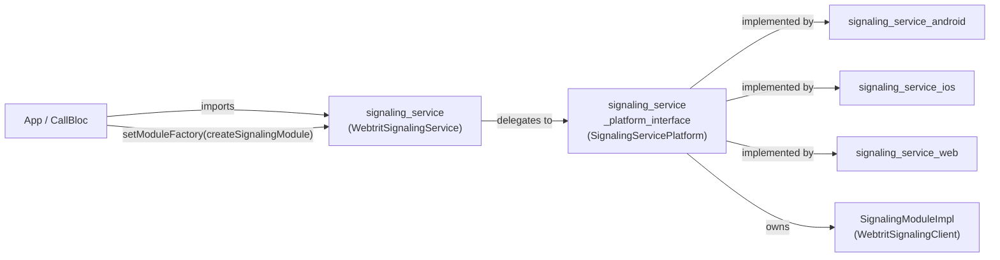
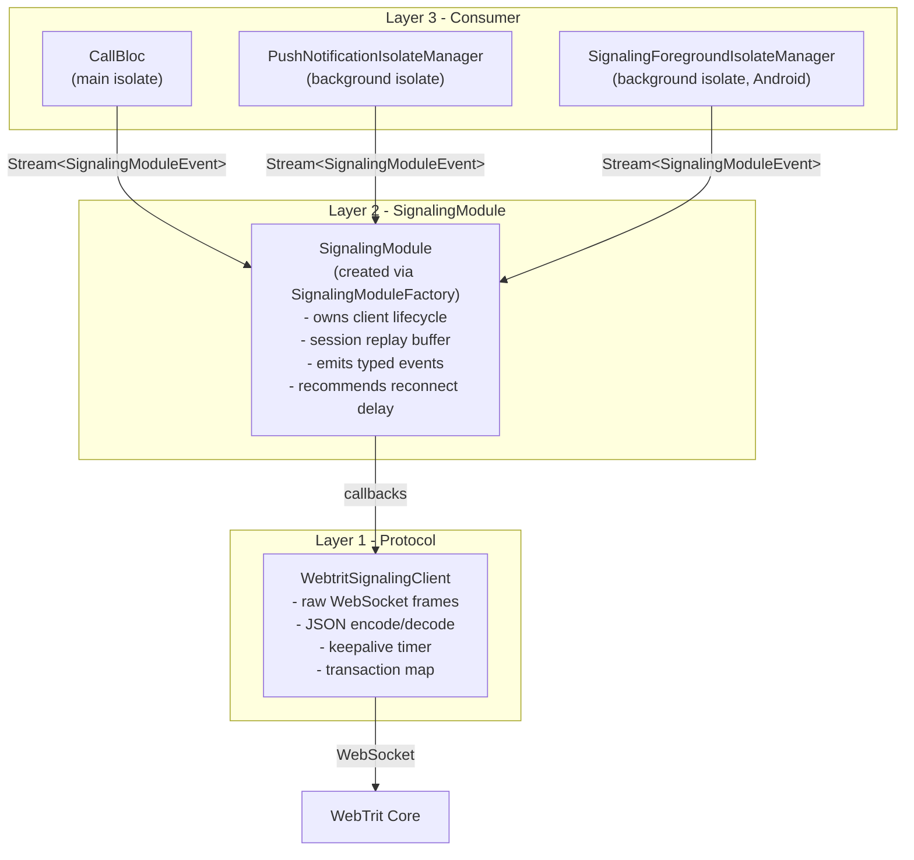
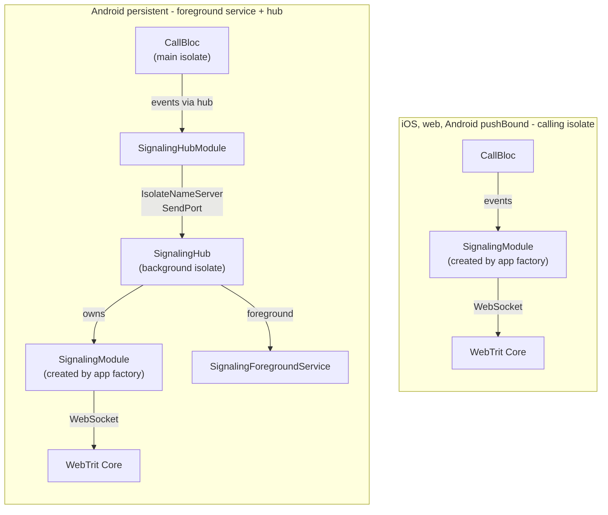
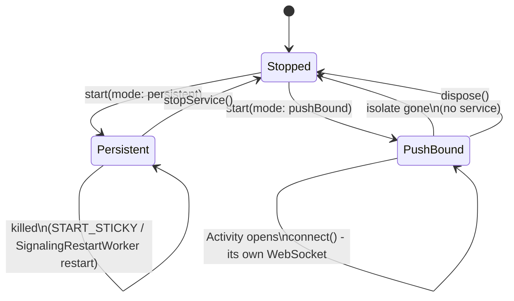
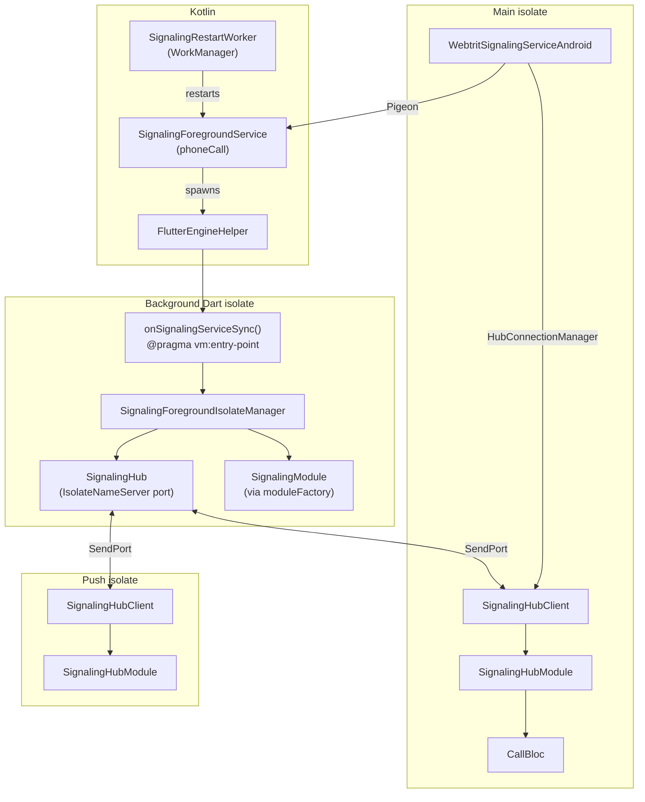

# signaling_service - Architecture

The plugin internals in one place: packages, layers, service modes, the Android hub, the event
model, the session buffer, the module factory and the background call handler. The package
`AGENTS.md` files describe their own classes and link here for these topics. How the app uses
the signaling layer (consumers, the reconnect controller, the push-bound handoff) is in
[signaling_architecture_target.md](../../docs/architecture/signaling_architecture_target.md).

---

## Package structure



`signaling` is a dependency of the platform interface and of all three platform packages. The
`lib/` of `signaling_service_platform_interface` (requests, events, `StateHandshake`, the
default module) and of `signaling_service_android` (the hub codec) import it; the `lib/` of
`signaling_service_ios` and `signaling_service_web` does not (iOS lists it for its tests).

The app registers the default factory through the facade:
`WebtritSignalingService.setModuleFactory(createSignalingModule)` (in `_initCallkeep`,
`lib/bootstrap.dart`), which forwards it to `SignalingServicePlatform.instance`. The plugin calls
the factory to create a `SignalingModule` and manages its lifecycle.

---

## Three-layer model

Each layer knows only the one below it, never the one above.



| Layer | Knows | Does NOT know |
|---|---|---|
| `WebtritSignalingClient` | Raw WebSocket, JSON protocol, transactions | App lifecycle, reconnect logic |
| `SignalingModule` (`SignalingModuleImpl`) | Disconnect codes, reconnect delay hints, session buffering, the request queue | Network state, active calls, whether to reconnect |
| Consumer (CallBloc / isolate managers) | App lifecycle, network, active calls | WebSocket internals |

---

## iOS, web and Android



On iOS and web, and on Android in `pushBound` mode, the socket lives in the isolate that
connects: `WebtritSignalingServiceDirect` (platform interface) does the work, and the iOS, web
and Android-direct classes are thin subclasses of it. On Android in `persistent` mode the socket
lives in a background isolate inside a foreground service: it survives app backgrounding and
dispatches incoming calls when the app is closed.

---

## Service modes

`SignalingServiceMode` has two values. The app maps the user's incoming-call type to one
(`IncomingCallType.toSignalingServiceMode()` in `lib/models/incoming_call_type.dart`):
`pushNotification` -> `pushBound`, `socket` -> `persistent`. `pushBound` is what the app passes
unless the user opts into socket mode; `persistent` is the default of the API
(`WebtritSignalingService` and `SignalingServicePlatform.start`) and has an effect only on
Android.



| | `persistent` (Android) | `pushBound` |
|---|---|---|
| Who owns the socket | the foreground service's background isolate | each isolate that connects |
| Survives app close | Yes | No - there is no service |
| Restart after a kill | `START_STICKY` and `SignalingRestartWorker`; no boot receiver | No |
| Incoming calls | WebSocket always live -> `IncomingCallEvent` in the background isolate | Server sends an FCM push (no live socket) |
| When the Activity opens | `connect()` - `HubConnectionManager` attaches to the running hub | `connect()` - opens its own WebSocket |
| Events reach consumers | encoded as JSON across the isolate boundary (hub codec) | as objects, no serialization |
| Foreground notification | always visible | none |

In `pushBound` mode the push isolate and the Activity each create their own instance and
connect directly (`WebtritSignalingServiceAndroidDirect` on Android); each socket closes with
its isolate, and the server then sends an FCM push for the next call.

`WebtritSignalingService.updateMode(mode)` switches the platform and every live instance of the
isolate. On Android the plugin clears its session buffer, tears down the transport of the old
mode (to `pushBound`: the hub and the foreground service; to `persistent`: the direct service)
and starts the new one, so one account never holds two sockets. On iOS and web it is a no-op.

### The persistent service and a refused start

The service is `foregroundServiceType="phoneCall"` and holds a partial `WAKE_LOCK`. A start
from the background is restricted for apps targeting API 31+ unless an exemption applies (a
high-priority FCM message, a notification interaction, ...), and for apps targeting API 35+
Android 15 forbids starting a `phoneCall` service from `BOOT_COMPLETED`; there is no boot
receiver. A refused start (`ForegroundServiceStartNotAllowedException`) is handled where it
happens:

- in `startForeground()` inside the service: the service stops itself and `onDestroy` enqueues
  `SignalingRestartWorker` in 15 s (only while credentials are stored);
- in the worker's own start: the worker returns `Result.retry()`, exponential backoff from 15 s;
- in the Pigeon `connect()` (`restoreService()`): the worker is enqueued in 15 s;
- in the Pigeon `startService()`: not caught, so it reaches the Dart caller -
  `WebtritSignalingService.connect()` logs it and clears its pending start, `updateMode()`
  rethrows it, the restart after the hub dies logs it.

`onTaskRemoved` enqueues the worker in 1 s, replacing any pending one.

---

## Android hub



The plugin lets a push isolate attach the same way, but the app's push isolate does not: on a
`persistent` device it calls `restoreService()` and returns
(`lib/features/call/services/background_isolate_callbacks.dart`).

### Hub wire protocol (Dart ports, no platform channels)

| Direction | Message | Description |
|---|---|---|
| Client -> Hub | `[sub, id, replyPort]` | Subscribe; the hub replies `sub_ack`, then the session's lifecycle events and a handshake rendered from its session snapshot |
| Client -> Hub | `[unsub, id]` | Unsubscribe |
| Client -> Hub | `[exec, id, corr, req]` | Execute a request; the hub replies `[execute_result, corr, error?]` |
| Client -> Hub | `[connect, id]` / `[disconnect, id]` | Ask the hub's module to connect / disconnect |
| Client -> Hub | `[ping, id]` | Liveness check; the hub replies `pong` |
| Hub -> Client | `SignalingModuleEvent` | Forwarded to every subscriber as it happens, JSON-encoded by the hub codec |

### Attaching to the hub (`HubConnectionManager`)

`HubConnectionManager` polls `IsolateNameServer` every 100 ms until the hub's port appears. For
each port it finds it builds a client and subscribes in this order:

```
awaitAck()   registers the ack Completer first, before the ack can arrive
start()      sends [sub, id, replyPort]; the hub sends sub_ack, then the lifecycle replay
await ack    safe now: start() already fired
```

Awaiting the future before `start()` always times out: `start()` is what triggers the ack. The
manager listens to the module's events before awaiting the ack, so the replay that follows the
ack is not lost. After 15 s without a port (`noPortTimeout`), or after 3 missed acks of 500 ms
in a row (`stalePortThreshold`; the stale port is removed), it emits `SignalingConnectionFailed`
and calls `onServiceDead`, which restarts the service when the mode is `persistent`. Once
attached, a lost hub (no pong) closes the client's stream and the manager starts discovery
again.

---

## Event model


`recommendedReconnectDelay` in `SignalingDisconnected`, as `SignalingModuleImpl` sets it:

| Value | Meaning |
|---|---|
| `Duration.zero` | Reconnect immediately (code 4441, `controllerForceAttachClose`: the server evicted a duplicate session) |
| `reconnectDelay` (3 s by default) | Standard slow reconnect, for every other code |
| `null` | Do not reconnect: the app itself called `disconnect()` |

`SignalingConnectionFailed` always carries `reconnectDelay`.

---

## Session replay buffer

`MainShell` connects in `initState()`, before `CallBloc` is built
(`lib/app/router/main_shell.dart`):

```dart
_signalingModule = context.read<SignalingServiceFactory>().create(config: ..., mode: ...)..connect();
```

`SignalingServiceFactory` (`lib/utils/signaling_service_factory.dart`) builds a
`WebtritSignalingService`. When `CallBloc` subscribes later it gets the session so far:

```
MainShell.initState()
  connect()
  buffered: Connecting, Connected, HandshakeReceived

CallBloc subscribes later: events.listen(...)
  [replay] SignalingConnecting
  [replay] SignalingConnected
  [replay] SignalingHandshakeReceived (rendered from the snapshot)
  [live]   later events
```

Every replay boundary - `SignalingModuleImpl` that owns the socket, the hub, the Android plugin
and `WebtritSignalingServiceDirect` that front them - keeps the same `SignalingEventBuffer`
(`signaling_service_platform_interface/lib/src/signaling_event_buffer.dart`), so no two of them
disagree about the session a late subscriber sees. `SignalingHubModule` keeps no buffer of its
own: `HubConnectionManager` listens to it before the hub's ack, and the hub's replay, which
follows the ack at once, is delivered once.

The rules:

- `SignalingConnecting` starts a new session: everything before it is dropped.
- Lifecycle events (`Connecting`, `Connected`, `ConnectionFailed`, `Disconnecting`,
  `Disconnected`) are kept in order and replayed as they came.
- The handshake is kept as a `SessionSnapshot`
  (`signaling_service_platform_interface/lib/src/session_snapshot.dart`): the `StateHandshake`
  the session opened with, kept current by the registration events, each call's events on its
  line (numbered or guest; newest first, as the server orders a log; a new call opens its line,
  a hangup or a missed call frees it at its position) and the conference block. Presence and
  dialog blocks, the keepalive interval and the timestamp stay as the handshake reported them.
  A late subscriber gets the handshake rendered from it - the one the server would send now -
  and takes the path it takes after a reconnect, where the server itself describes calls that
  are already up. A second handshake in one session replaces the state and is replayed once.
- `SignalingProtocolEvent` is never replayed: what it changed is in the snapshot, and the rest
  (ICE candidates, DTMF, a media state a live call already applied) is not actionable later.

`sessionHandshake` on every boundary that keeps the buffer returns the same rendered handshake,
for a consumer that planned from an older one (`SignalingHubModule`, with no buffer, returns
`null`; the Android plugin in front of it answers from its own buffer). Because every boundary keeps the same buffer, a call that ended
between one boundary's replay and the next is gone at both.

---

## Reconnect - who decides what

`SignalingModule` owns the protocol knowledge (what a disconnect code means, as
`recommendedReconnectDelay`), and the consumer owns the decision - in the main isolate
`SignalingReconnectController` (`lib/features/call/services/signaling_reconnect_controller.dart`,
created by `CallBloc`), which also weighs the app state, the network and active calls. The split
and each consumer's rules are in
[signaling_architecture_target.md](../../docs/architecture/signaling_architecture_target.md)
(sections "Reconnect - responsibility split" and "SignalingReconnectController").

---

## Background incoming call handler (Android)

When the app is closed and the service runs in `persistent` mode, call events arrive in the
background isolate. The plugin dispatches them to a registered Dart callback:

```
SignalingForegroundIsolateManager receives IncomingCallEvent / HangupEvent
  _dispatchCallEvent(event)
    PluginUtilities.getCallbackFromHandle(callEventHandlerHandle)
      onSignalingBackgroundCallEvent(event)         (app side)
        report the incoming call to callkeep / release the call
```

The callback must be a top-level function annotated `@pragma('vm:entry-point')`. The app
registers it with `WebtritSignalingService.setCallEventHandler(onSignalingBackgroundCallEvent)`
in `lib/bootstrap.dart`, on Android only. The plugin resolves its handle with
`PluginUtilities.getCallbackHandle(callback)` and persists it to `SharedPreferences`; the
background isolate reads it at each sync, so the main isolate does not need to be alive. It is
invoked with `Function.apply`, sync or async, and its errors are logged. With no handler
registered (handle `0`) the manager logs a warning and the event reaches only hub subscribers.

In `pushBound` mode the handler is not involved: the push isolate opens its own socket and the
app's push code reports the call to callkeep
(`lib/features/call/services/background_isolate_callbacks.dart`). On iOS and web
`setCallEventHandler` is a no-op; iOS reports incoming calls through PushKit and callkeep.

---

## Module factory

The plugin creates its `SignalingModule` through a `SignalingModuleFactory` the app registers at
startup:

```dart
typedef SignalingModuleFactory = SignalingModule Function(SignalingServiceConfig config);
```

The default factory and module live in
`signaling_service_platform_interface/lib/src/signaling_module_impl.dart`:

```dart
// @pragma required so PluginUtilities can serialize it across isolates
@pragma('vm:entry-point')
SignalingModule createSignalingModule(SignalingServiceConfig config) { ... } // a SignalingModuleImpl
```

App side (`_initCallkeep` in `lib/bootstrap.dart`, before the first instance):

```dart
await WebtritSignalingService.setModuleFactory(createSignalingModule); // every platform
if (kIsWeb || !Platform.isAndroid) return;
await WebtritSignalingService.setCallEventHandler(onSignalingBackgroundCallEvent);
```

The push isolate is a separate Dart VM and calls `setModuleFactory` again itself
(`background_isolate_callbacks.dart`). Without a registered factory
`WebtritSignalingServiceDirect.start()` throws `StateError`.

How the factory reaches the background isolate (Android):

```
setModuleFactory(factory)
  PluginUtilities.getCallbackHandle(factory)          raw int handle
    PSignalingServiceHostApi.saveModuleFactory(handle)
      Kotlin: StorageDelegate                         SharedPreferences

onSignalingServiceSync(status)                        background isolate
  status.moduleFactoryHandle                          delivered by synchronizeIsolate()
    PluginUtilities.getCallbackFromHandle(handle) as SignalingModuleFactory
      factory(config)                                 creates the SignalingModule
```

On iOS, web and Android `pushBound` the factory is kept in memory by
`WebtritSignalingServiceDirect` and called in `start()`; there is no isolate boundary to cross.

---

## Key design decisions

| Question | Decision | Why |
|---|---|---|
| `connect()`: Future or fire-and-forget? | Fire-and-forget | The result arrives through the stream; two channels for the same fact are redundant |
| Where does protocol knowledge live? | `SignalingModule` | Disconnect codes and delays are protocol detail, not app logic |
| Where does the reconnect decision live? | Consumer | Only the consumer knows app state, network and active calls |
| Session buffer: replay history or state? | State: `SignalingEventBuffer` with a `SessionSnapshot` | A late subscriber needs the calls that are up now, not the events that led there; replaying history would re-live ended calls |
| `dispose()` closes the events stream? | No | Closing would end active subscribers through `onDone`; the plugin is a singleton and the stream stays open across `dispose`/`start` cycles (logout and re-login in one process) |
| iOS background service? | No - the calling isolate only | iOS suspends background processes; there is no equivalent of the Android foreground service |
| Module created by the plugin or the app? | The app's factory | The factory lets the Android service isolate create the module from a serialized callback handle |
