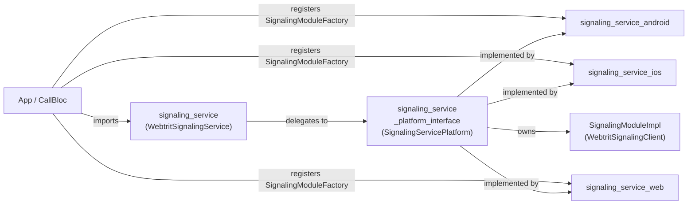
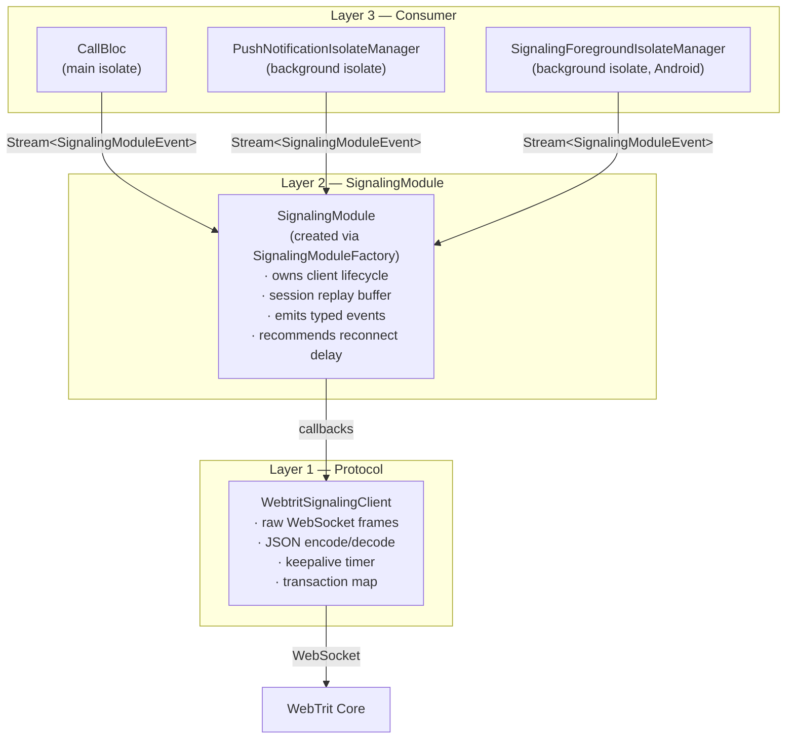
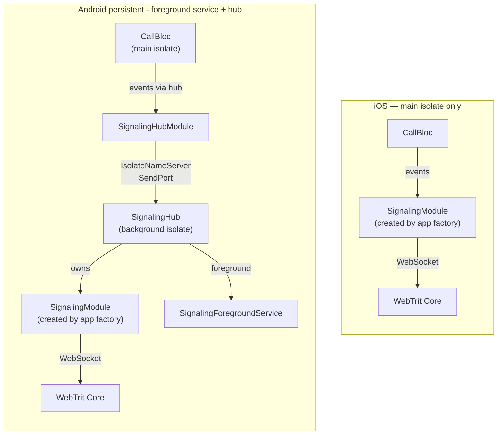
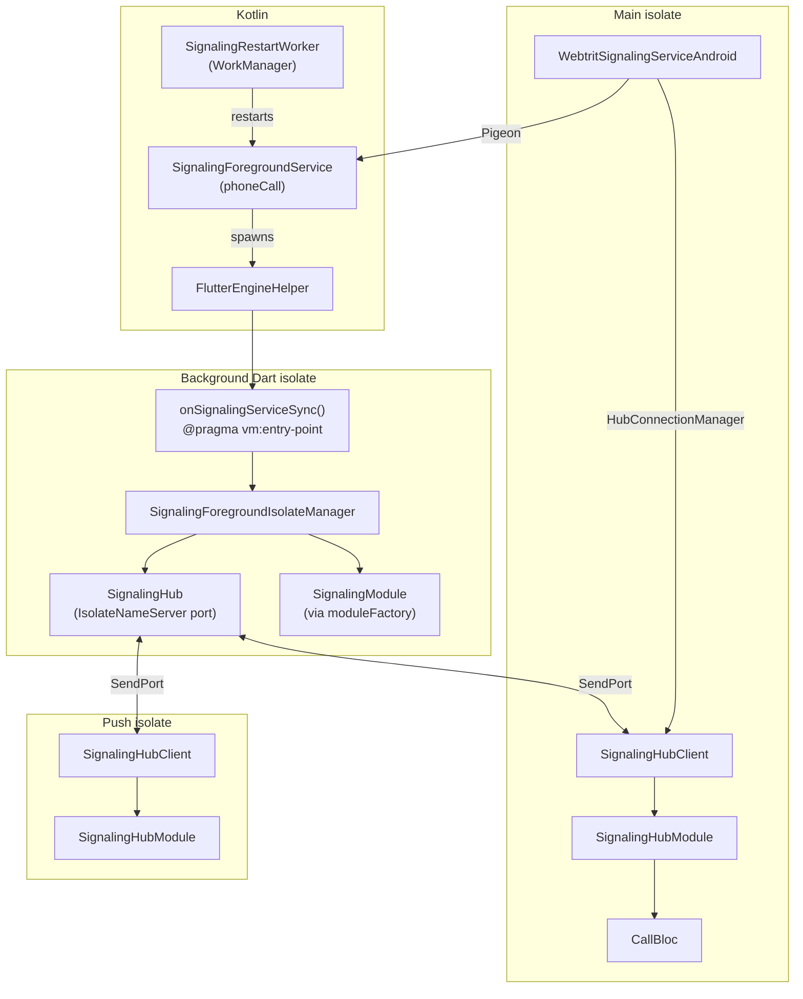
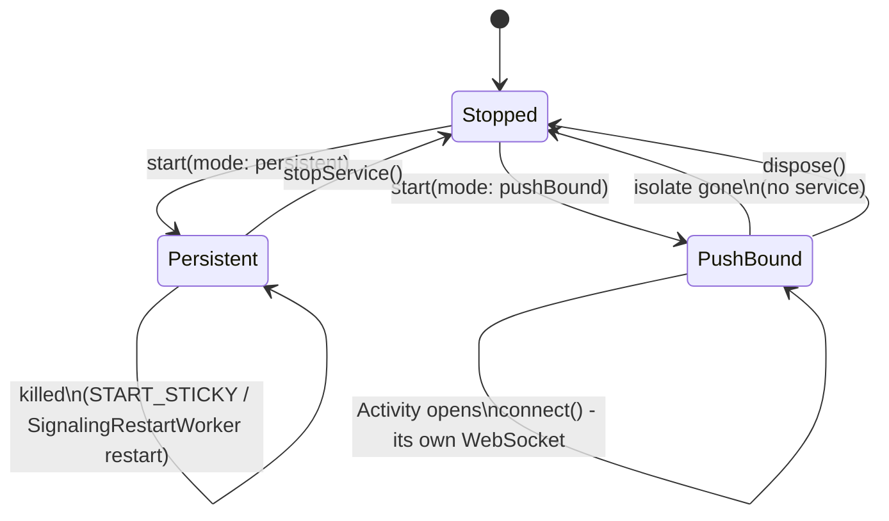
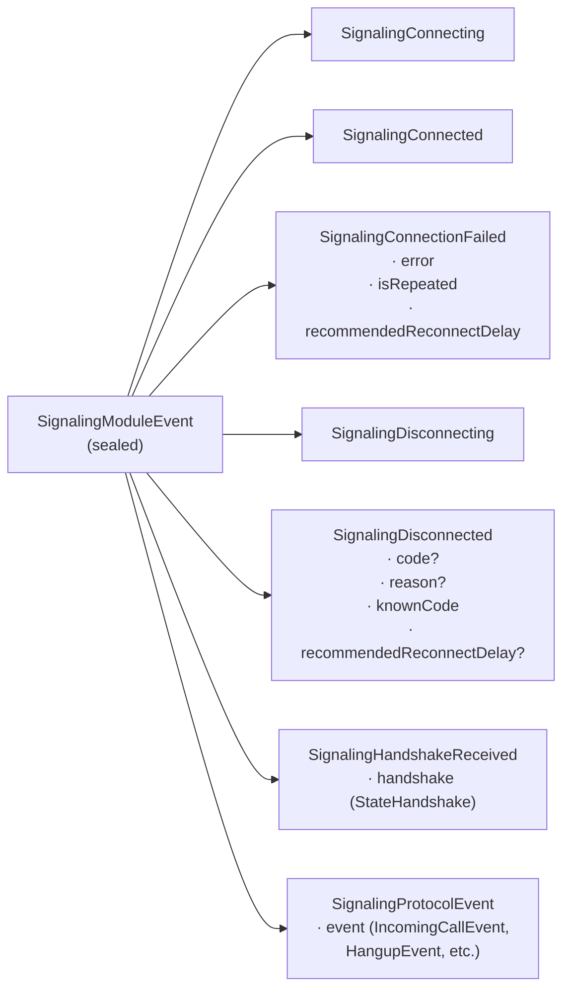
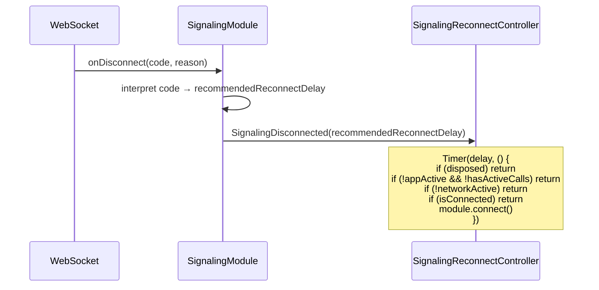

# signaling_service — Architecture

> Plugin internals: layers, hub, isolates, modes, event model.
> For app-level integration see [
`docs/architecture/signaling_architecture_target.md`](../../docs/architecture/signaling_architecture_target.md).

---

## Package structure



All three platform packages list `signaling` in `pubspec.yaml`, but only the `lib/` of
`android` imports it.
The app registers a `SignalingModuleFactory` callback (`createSignalingModule` from the platform
interface) via `setModuleFactory()` - the plugin calls it to create a `SignalingModule` instance
and manages its lifecycle.

---

## Three-layer model

Each layer knows only the one below it — never above.



| Layer                                  | Knows                                                      | Does NOT know                                     |
|----------------------------------------|------------------------------------------------------------|---------------------------------------------------|
| `WebtritSignalingClient`               | Raw WebSocket, JSON protocol, transactions                 | App lifecycle, reconnect logic                    |
| `SignalingModule` (`SignalingModuleImpl`) | Disconnect codes, reconnect delay hints, session buffering | Network state, active calls, whether to reconnect |
| Consumer (CallBloc / IsolateManager)   | App lifecycle, network, active calls                       | WebSocket internals                               |

---

## iOS vs Android



On iOS and web, and on Android in `pushBound` mode (what the app passes unless the user opts into
socket mode), the socket lives in the isolate that connects.
On Android in `persistent` mode the socket lives in a background isolate inside a foreground service - it survives
app backgrounding and dispatches incoming calls when the app is closed.

---

## Android hub architecture



The plugin lets a push isolate attach the same way, but the app's push isolate does not: on a
`persistent` device it calls `restoreService()` and returns
(`lib/features/call/services/background_isolate_callbacks.dart`).

### Hub wire protocol (pure Dart ports — no platform channels)

| Direction    | Message                   | Description                                                 |
|--------------|---------------------------|-------------------------------------------------------------|
| Client -> Hub | `[sub, id, replyPort]`    | Subscribe; hub replies with ack, then the session's lifecycle events and a handshake rendered from its session snapshot |
| Client -> Hub | `[unsub, id]`             | Unsubscribe                                                 |
| Client -> Hub | `[exec, id, corr, req]`   | Execute request; hub replies `[execute_result, corr, error?]` |
| Client -> Hub | `[connect, id]` / `[disconnect, id]` | Ask the hub's module to connect / disconnect     |
| Client -> Hub | `[ping, id]`              | Liveness check; hub replies with a pong                     |
| Hub → Client | `SignalingModuleEvent`    | Forwarded to every subscriber in real time                  |

### Hub subscribe sequence (`HubConnectionManager`) - why `awaitAck` comes before `start()`

```
awaitAck()   ← registers the internal Completer FIRST (before ack can arrive)
start()      ← sends ['sub', id, replyPort] to hub → hub sends sub-ack + lifecycle replay with the current handshake
await ack    ← now safe to wait; ack arrives because start() already fired
```

`HubConnectionManager` first polls `IsolateNameServer` every 100 ms until the hub's port appears;
after 15 s without one (`noPortTimeout`), or after 3 missed acks of 500 ms in a row, it emits
`SignalingConnectionFailed` and calls `onServiceDead`.
Awaiting the future before `start()` always times out — `start()` is what triggers the ack.

---

## Service modes



|                     | `persistent`                                       | `pushBound`                                  |
|---------------------|----------------------------------------------------|----------------------------------------------|
| Who starts it       | the app, through `connect()` in the main isolate   | nothing - each isolate opens its own socket  |
| Survives app close  | Yes                                                | No - there is no service                     |
| Restart after a kill | `START_STICKY` and `SignalingRestartWorker`; no boot receiver | No                              |
| Incoming calls      | WebSocket always live → direct `IncomingCallEvent` | Server sends FCM push (no active socket)     |
| When Activity opens | `connect()` - `HubConnectionManager` connects to running hub | `connect()` - opens its own WebSocket |
| `onStartCommand`    | `START_STICKY`                                     | not used                                     |
| Foreground notification | always visible                                 | none                                         |

In `pushBound` mode the push isolate and the Activity each create their own instance and connect
directly (`WebtritSignalingServiceAndroidDirect`); each socket closes with its isolate, and the
server then sends an FCM push for the next call.

The `persistent` service is `foregroundServiceType="phoneCall"` and holds a `WAKE_LOCK`. A start
from the background is restricted for apps targeting API 31+ unless an exemption applies, and
for apps targeting API 35+ Android 15 forbids starting a `phoneCall` service from
`BOOT_COMPLETED`. A refused start
(`ForegroundServiceStartNotAllowedException`) is handled where it happens: in `startForeground()`
the service stops itself and `onDestroy` enqueues `SignalingRestartWorker` in 15 s; in the worker's
own start the worker returns `Result.retry()` (exponential backoff from 15 s); in
`restoreService()` the worker is enqueued in 15 s; in the Pigeon `startService()` the error reaches
the Dart caller: `connect()` logs it and clears its pending start, `updateMode()` rethrows it,
the restart after the hub dies logs it.

---

## Event model



`recommendedReconnectDelay` in `SignalingDisconnected`:

| Value                  | Meaning                                                              |
|------------------------|----------------------------------------------------------------------|
| `Duration.zero`        | Reconnect immediately (code 4441 — server evicted duplicate session) |
| `Duration(seconds: 3)` | Standard slow reconnect                                              |
| `null`                 | Do not reconnect (protocol error)                                    |

---

## Session replay buffer

`connect()` is called in `initState()` — before `CallBloc` is built. When `CallBloc` subscribes
later it gets the full session history via the buffer:

```
_MainShellState.initState()   (lib/app/router/main_shell.dart)
  └─ SignalingModule.connect()

  buffered:  Connecting → Connected → HandshakeReceived(lines)

CallBloc constructed later:
  └─ service.events.listen(...)
       ├─ [replay] SignalingConnecting
       ├─ [replay] SignalingConnected
       ├─ [replay] SignalingHandshakeReceived
       └─ [live]   future events...
```

`SignalingConnecting` clears the buffer - each reconnect starts fresh.
`SignalingHubModule` keeps no buffer of its own: `HubConnectionManager` listens to it before the
hub's ack, and the hub's replay, which follows the ack at once, is delivered once.

The buffer replays state, not history: a `SessionSnapshot` (in `signaling_service_platform_interface`)
keeps the handshake the session opened with current with the registration events and every call's
events on its line (numbered or guest; a hangup frees the line at its position), and `snapshot`
renders the handshake the server would send now. A subscriber that attaches late - a new isolate
subscribing to the hub, or a consumer subscribing to the plugin after it connected - takes the path it
takes after a reconnect, where the server itself describes calls that are already up. Protocol
events are never replayed; what they changed is in the snapshot. Because every boundary keeps the
same buffer, a call that ended between one boundary's replay and the next is gone at both.

---

## Reconnect — who decides what



`SignalingModule` owns **protocol knowledge** (what the code means).
`SignalingReconnectController` (`lib/features/call/services/signaling_reconnect_controller.dart`,
created by `CallBloc`) owns **app context** (whether reconnect makes sense right now).

---

## Background incoming call handler (Android)

When the app is closed and the service runs in `persistent` mode, call events arrive in
the background isolate. The plugin dispatches them via a registered Dart callback:

```
SignalingForegroundIsolateManager receives IncomingCallEvent / HangupEvent
  └─ _dispatchCallEvent(event)
       └─ PluginUtilities.getCallbackFromHandle(callEventHandlerHandle)
            └─ onSignalingBackgroundCallEvent(event)   ← app-side
                 └─ callkeep.reportNewIncomingCall(...) / release the call
```

The callback must be a **top-level function** annotated `@pragma('vm:entry-point')`.
The plugin resolves the raw handle internally via `PluginUtilities.getCallbackHandle(callback)`
and persists it to `SharedPreferences`; the background isolate reads it at each sync —
the main isolate does not need to be alive.

In `pushBound` mode the handler is not involved: the push isolate opens its own socket and the
app's push code reports the call to callkeep (`lib/features/call/services/background_isolate_callbacks.dart`).
On iOS and web `setCallEventHandler` is a no-op; iOS reports incoming calls through PushKit.

---

## Module factory pattern

The plugin creates its `SignalingModule` through a `SignalingModuleFactory` callback the app
registers at startup:

```dart
typedef SignalingModuleFactory = SignalingModule Function(SignalingServiceConfig config);
```

### App-side setup (bootstrap.dart)

```dart
// Top-level factory in signaling_service_platform_interface/lib/src/signaling_module_impl.dart
// - @pragma required so PluginUtilities can serialize it across isolates
@pragma('vm:entry-point')
SignalingModule createSignalingModule(SignalingServiceConfig config) {
  return SignalingModuleImpl(
    coreUrl: config.coreUrl,
    tenantId: config.tenantId,
    token: config.token,
    trustedCertificates: config.trustedCertificates,
  );
}

// Called once at bootstrap, before the first instance; the handler on Android only
await WebtritSignalingService.setModuleFactory(createSignalingModule);
await WebtritSignalingService.setCallEventHandler(onSignalingBackgroundCallEvent);
```

### How the factory reaches the background isolate (Android)

```
setModuleFactory(factory)
  └─ PluginUtilities.getCallbackHandle(factory) → raw int handle
       └─ PSignalingServiceHostApi.saveModuleFactory(handle)
            └─ Kotlin: StorageDelegate.saveModuleFactoryHandle(handle)
                 └─ SharedPreferences

onSignalingServiceSync(status)   ← background isolate
  └─ status.moduleFactoryHandle  ← read from SharedPreferences via synchronizeIsolate()
       └─ PluginUtilities.getCallbackFromHandle(handle) as SignalingModuleFactory
            └─ factory(config)   ← creates SignalingModule
```

On iOS, web and Android `pushBound` the factory is stored in memory and called directly in `start()` - no isolate boundary to cross.

---

## Key design decisions

| Question                                         | Decision                    | Why                                                                                                                      |
|--------------------------------------------------|-----------------------------|--------------------------------------------------------------------------------------------------------------------------|
| `connect()` — Future or fire-and-forget?         | Fire-and-forget             | Result arrives via stream; two channels for the same fact are redundant                                                  |
| Where does protocol knowledge live?              | `SignalingModule`           | Disconnect codes and delays are protocol detail, not app logic                                                           |
| Where does reconnect decision live?              | Consumer                    | Only the consumer knows app state, network, and active calls                                                             |
| Session buffer — `rxdart` or manual?             | Manual `List`               | `ReplaySubject` has no `clear()` in v0.28; manual list gives full control                                                |
| `dispose()` closes the events stream?            | No                          | Closing would silently terminate active BLoC subscribers via `onDone`; stream stays open across `dispose`/`start` cycles |
| iOS background service?                          | No — main isolate only      | iOS suspends background processes; no equivalent of Android foreground service                                           |
| Plugin depends on `signaling` directly?  | Yes; module via factory callback | The factory lets the Android service isolate create the module from a serialized callback handle                   |
